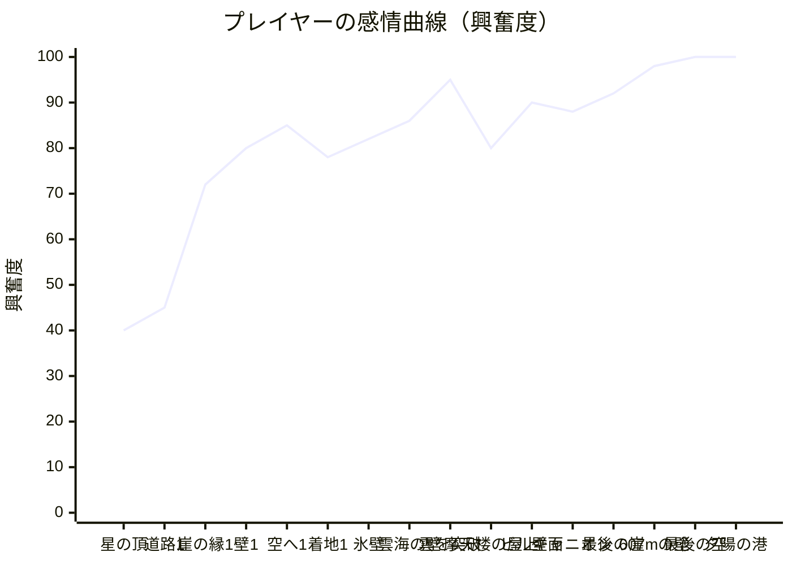

# 天空ドロップ・ロードスター — ジャーニーマップ設計書

> 「普段は道を走る車が、崖の縁に来たら、そのまま垂直に駆け降りる」
> 崖の縁でお腹がふわっと浮く一瞬と、重力に引きずられる加速、
> ジャンプ台から空へ放り出されて着地する解放感を、**6回、だんだん大きく**味わわせる。

ベースは「絶壁ロードスター（CLIFF ROADSTER）」のエンジン（Three.js 描画・Web Audio 合成サウンド・道路区間・着地ガイド）。
「登る」ゲームを裏返し、**標高2600mの星の頂から、海抜0mの夕陽の港まで降りる旅**として、全体を作り直した。

---

## 0. 「登る」と「降りる」は、緊張の向きが逆

| | 絶壁ロードスター（登る） | 天空ドロップ（降りる） |
|---|---|---|
| 壁の上の敵 | 重力で**減速**して失速する | 重力で**加速**し続けて、止まらない |
| 噴射の役割 | 加速（押し上げる） | **ブレーキ**（逆噴射で踏ん張る） |
| 失敗の形 | 遅すぎて落ちる（失速） | **速すぎて剥がれる**（グリップ限界） |
| 一番の見せ場 | 頂上から空へ跳ぶ | **崖の縁でドロップイン** → ジャンプ台から空へ |
| 報酬の形 | 標高が上がる | 標高が下がり、景色が**近づいてくる** |

「速さ＝怖さ＝気持ちよさ」が同じ軸に乗るのが降下の面白さ。
だから壁の上では **速度計の赤い帯（REDLINE）** に張り付くほど得点が2倍になり、
超えたままだとグリップ・メーターが削れて壁から剥がれる。**ギリギリを攻めるほど報われる**ように設計した。

---

## 1. 感情曲線（1プレイ ≒ 4〜5分）

**原則：谷（休息）は必ずあるが、毎回「前の山より高い山」を置く。**
道路区間で息を整え（＝期待を溜める）、崖の縁で一瞬止まり（＝恐怖）、壁で加速の緊張を最大化し、ジャンプ台で一気に解放、K点で達成感。
この「溜め → 恐怖 → 緊張 → 解放 → 達成」の1サイクルを6回、規模を上げながら繰り返す。

---

## 2. ジャーニーマップ（フェーズ別）

| フェーズ | プレイヤーの行動 | 心の声 | 感情 | ペインポイント | 設計での対策 |
|---|---|---|---|---|---|
| **① タイトル** | 地図を眺める | 「2600mから、海まで降りるの?」 | 期待・畏怖 | 何をするゲームか分からない | ロゴ自体が「崖を駆け降りてジャンプ台で跳ねる道」。**ジャーニーマップ**は崖の階段が海へ続く断面図で、旅の全体像と標高を先に見せる |
| **② 出発（CH1 星の頂）** | シグナルで発進、最初の谷を跳ぶ | 「星がすごい。操作は簡単そう」 | 安心 → 高揚 | 操作が分からない | 文脈ヒント・着地ガイドを継承。最初の谷は確実に越えられる長さ |
| **③ 崖の縁が見える** | 道の先が空で途切れている | 「え、道が…ない!?」 | **恐怖・驚き** | 崖＝行き止まりに見える | 「崖まで170m」ゲート、「▼ DROP IN」ゲート、レーダー「▼崖まで◯m — ドロップイン!」で**そのまま進めばいい**と伝える。助走路のAIRセルで「ブレーキ用のAIR」を満タンに |
| **④ ドロップイン** | 縁を越えて垂直に | 「落ちる…いや、走ってる!!」 | **絶叫系の興奮** | — | 一瞬のスローモーション、カメラが縁の上に浮いて**奈落を見せる**、BGMが無音になり、サブベースの「ドーン」と落ちていくスイープ音。最初の壁は90mで**何もしなくても成功する** |
| **⑤ 壁を駆け降りる** | 加速、噴射でブレーキ | 「速い速い速い!」 | **興奮・緊張** | 速度の管理が分からない | 速度計が赤＝REDLINE（×2）、超えると揺れ・タイヤの悲鳴・赤いビネット・GRIPメーターが減る。「噴射でブレーキ!」のレーダー。グリップは**1秒前後の猶予**があり、理不尽に即死しない |
| **⑥ ジャンプ台から空へ** | 壁の終わりで空へ放り出される | 「飛んだーー!」 | **解放** | — | スロー＋サイドカメラ、大和音とベル、ライブの**飛距離カウンター**、BGMが空中でこもって「浮遊感」 |
| **⑦ 着地・K点** | 斜面に着地 | 「K点越えた!!」 | **達成** | 着地で激突する | 着地斜面（スキージャンプのランディングバーン）で、斜面に沿って降りれば衝撃は小さい。着地点ガイドが緑／黄／赤で知らせ、「斜面の近くで噴射」で減速。K点越えはファンファーレと花火 |
| **⑧ 次の章へ** | 地図で次の崖へ | 「次はどこまで落ちる?」 | 満足 → 好奇心 | 満足して止めてしまう | **ジャーニーバナー**で地図上の車が一段下の崖へ移動。ライフ+1、AIR補充。BGMが次の章の曲へ |
| **⑨ 氷壁（CH2）** | 氷の上でブレーキが効かない | 「止まらない…!」 | 緊張 | 理不尽に感じる | 「❄ 氷 — ブレーキが効かない!」を手前で予告。氷の手前で減速しておけば越えられる＝**読みの楽しさ** |
| **⑩ 雲海ダイブ（CH3）** | 壁の途中で雲に突っ込む | 「真っ白… 抜けた! 地上だ!」 | **感動** | — | 雲の中でホワイトアウト → 突き抜けた瞬間に地上の世界が一気に見える。専用効果音と「雲を突き抜けた!」演出 |
| **⑪ 摩天楼（CH4）** | ビルの屋上から壁面を駆け降りる | 「ビルの壁を走ってる!」 | 興奮 | 室外機（岩棚）が多い | 赤いランプとレーダーで早めに予告。速いほど早く迫る＝速度管理の意味が増す |
| **⑫ キャニオン（CH5）** | 背後から落石が追ってくる | 「後ろから来る!」 | 緊張（最大級） | 見えない後ろが怖い | 落石は警告音・左右に定位した地鳴り・レーダー「▲背後から落石!」で約2秒前に予告。**車線を変える**か、**ブレーキを離して振り切る**か、2つの解き方 |
| **⑬ 最後の崖（CH6・607m）** | 夕陽の海へ、最長の壁 | 「長い… でも海が近づいてくる」 | 緊張の頂点 | 長さで疲れる | 降りるほど**空が次の章へブレンド**し、夕焼けの港の色になっていく。ジャンプ台が近づくほどスネアロールが細かくなる。「ジャンプ台200m/100m/50m」標識 |
| **⑭ 夕陽の港・GOAL** | 着地してゴールゲートへ | 「帰ってきた!!」 | **最高潮** | — | 夕陽の空、ファンファーレ、連続花火、タイム表示 |
| **⑮ リザルト** | 結果と地図を見る | 「次はK点を全部…」 | 誇り → 再挑戦意欲 | やり込む理由がない | 章ごとの★3（着地成功／ノーミス／K点越え）、最長ジャンプ、最高速度、帰還タイム、ランク、**到達した章から再挑戦** |

---

## 3. 「興奮が止まらない」ための仕掛け

### 3-1. エスカレーション（毎回、前より大きく）
| 章 | 舞台 | 標高 | 壁の落差 | 新しい要素 |
|---|---|---|---|---|
| 1 | 星の頂（星空・月・オーロラの気配） | 2600m | 90m | 勢いだけで降りられる |
| 2 | オーロラ氷壁（雲の上） | 2354m | 150m | 氷（ブレーキが効かない）、岩棚、背後からの落石 |
| 3 | 雲海ダイブ（夜明けの雲の上） | 2051m | 220m | **壁の途中で雲海を突き破る** |
| 4 | ネオン摩天楼（ビルの屋上→壁面） | 1681m | 290m | 室外機の岩棚が連続、ネオン |
| 5 | 赤岩キャニオン（滝・メサ） | 1245m | 360m | 落石の連続 |
| 6 | 黄金の海岸線（夕陽の海） | 743m | 607m | 全部入り、**夕陽の港でゴール** |

（各章の標高は、壁の落差＋ジャンプ台から着地斜面までの落差から自動で計算され、最後が必ず海抜0mになる）

### 3-2. 緊張と解放のコントラスト
- **恐怖**：崖の縁。道が空で途切れる景色を、助走路の間ずっと見せる。
- **緊張**：壁では重力で加速し続ける。噴射＝ブレーキはAIRを使うので、使いすぎるとジャンプ台の手前でAIRが尽きる。
- **欲**：REDLINEは×2。ジャンプ台の速度がそのまま飛距離になり、K点を越えるには**限界ギリギリで飛び出す**必要がある。
- **予告**：落石・岩棚・氷はすべて、警告音・レーダー・光で事前に知らせる（理不尽さを消す）。
- **解放**：ジャンプ台は12°のキッカー。スロー＋横カメラで「見せ場」になる。
- **技術**：着地斜面の近く（6〜22m）でだけ逆噴射が強く効く。滑空はできないので、飛距離は壁で稼ぐしかない。

### 3-3. 視覚
- 崖の縁でカメラが一瞬浮き上がり、画角が開いて**奈落が画面いっぱい**に。世界が90°前に倒れる。
- 壁から突き出した岩柱（バットレス）が、駆け降りると**上へ流れ去る**縦のパララックス。
- 速度に応じて放射ブラー・色収差・スピードライン。REDLINEでは画面が細かく震え、速度計が赤く光る。
- 降りるほど空が次の章の空へブレンド。星空 → オーロラ → 夜明け → ネオン → 夕焼けのキャニオン → 金色の海 → 夕陽の港。
- 雲海レイヤー（標高1941m）：上からは雲の海、中はホワイトアウト、抜けると地上が一気に見える。
- 着地斜面には10mごとの距離ライン、50mごとの標識、赤く光る**K点ライン**。ジャンプの軌道上にリングを並べて「理想のライン」を見せる。
- 着地：紙吹雪、K点越えで花火。ゴール：連続花火。

### 3-4. 聴覚（すべて Web Audio でリアルタイム合成）
- 章ごとに調とテンポが変わるBGM（着地するたびに次の章の曲へ）。降りるほどテンポが上がり、最後の崖は134BPM、ゴールは穏やかな100BPM。
- **ドロップイン**：BGMを一瞬カット → サブベースの衝撃音 → 2オクターブ落ちていくスイープ＋沈んでいく和音。
- **壁の上**：16分ハイハット、ベース倍速、**下降するアルペジオ**、毎小節落ちていく「ダウンリフター」、ジャンプ台に近いほど細かくなるスネアロール。
- **風**：速度の2乗で轟音になり、REDLINEで帯域が開く。落下のヒュー音（タービンの高音）が速度と一緒に上がる。
- **グリップ限界**：タイヤの悲鳴（ランダムな帯域ノイズ）、警報ビープ、心拍のような低音。
- **ジャンプ台**：風切り音のスイープ → 大和音とベルのアルペジオ。空中ではBGMがローパスでこもり、着地で戻る。
- **K点越え**：ブラスのファンファーレと歓声のようなノイズのうねり、花火。

### 3-5. 満足と継続
- ★3 × 6章 = 18個のスター、最長ジャンプ、最高速度、帰還タイム、ノーミス帰還で S ランク。
- ドロップを制覇すると次の章が**出発地点として解放**（タイトルの地図から選べる）。
- 着地するたびにライフ+1、AIRを補充 → 「越えれば報われる」。
- 壁で失敗したら**その崖の助走路から**すぐやり直し（長い道路を走り直させない）。

---

## 4. 実装との対応

| 体験 | 実装 |
|---|---|
| 崖の形状 | `js/world.js` `dropShape()`：縁の丸み(R14, 0°→-90°) → 垂直の壁 → キッカー(R18, -90°→+12°) |
| 標高の計画 | `js/world.js` `flightLand()` と `ALT`：着地斜面の長さを設計速度から求め、最後が0mになるよう最後の壁の落差を決める |
| 壁の物理 | `js/game.js` `wallStep()`：重力 `G·0.8·(-sinθ)`、空気抵抗、逆噴射ブレーキ、氷、パッド、REDLINE、グリップ |
| 空中から崖へ | `W.dropContact()` → `enterWall(..., fromAir)`（エア・ドロップイン） |
| ジャンプ台 | `takeoff()`：12°で射出、スロー・横カメラ・飛距離カウンター |
| 着地斜面とK点 | `makeHill()`（距離ライン・K点・理想ラインのリング）、`land()`（斜面に対する衝撃、K点判定、★） |
| 雲海 | `makeCloud()` / `updateCloud()`（標高1941mのレイヤーと霧のホワイトアウト） |
| ジャーニーマップ | `journeySVG()`、タイトル・章間バナー・リザルトで共通 |
| 壁のBGM | `js/audio.js` `setWall()` / `drop()`、効果音 `dropin` / `takeoff` / `kpoint` / `squeal` / `redline` |
